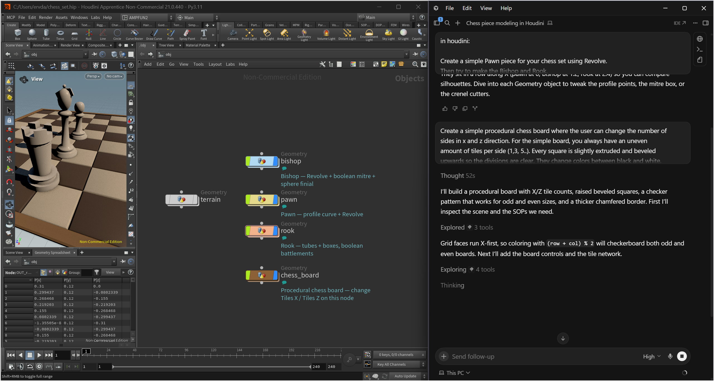

<p align="center">
  
</p>

<p align="center">
  <strong>Tell Cursor to build in Blender or Houdini. Watch it happen on your machine.</strong>
</p>

<p align="center">
    <a href="https://github.com/Plygonality/Plygon-mcp/blob/main/LICENSE"></a>
    <a href="blender-mcp/"></a>
    <a href="houdini-mcp/"></a>
    <a href="blender-mcp/"></a>
    <a href="blender-mcp/"></a>
</p>

# Plygon

A tech-art studio repo of **local MCP bridges** you can fork, run, and actually own.

Cursor's agents already write code. **Plygon gives them hands inside your DCC** — inspect the scene, make edits, and screenshot the viewport so they can check their own work. The bridge has no telemetry, and its DCC connection stays on IPv4 loopback by default.

The bridge is local; Cursor's model may not be. Tool results—including scene metadata and screenshots—become part of your Cursor conversation and may be sent to the model provider configured in Cursor. Check that provider's privacy settings before using sensitive production files.

Local, no-telemetry fork of the [ahujasid/blender-mcp](https://github.com/ahujasid/blender-mcp) localhost-TCP + FastMCP pattern, shaped for Cursor and studio pipelines. See [`THIRD_PARTY.md`](THIRD_PARTY.md).

| Bridge | Port | Docs |
|--------|------|------|
| [Blender MCP](blender-mcp/) | `127.0.0.1:9876` | [`blender-mcp/README.md`](blender-mcp/README.md) |
| [Houdini MCP](houdini-mcp/) | `127.0.0.1:9877` | [`houdini-mcp/README.md`](houdini-mcp/README.md) |

There are **two processes** per DCC. Cursor spawning the MCP (green in **Customize → MCPs**, tools listed) is not the same as Blender or Houdini listening on that port.

```
You → local Cursor Agent  →  plygon-*-mcp (stdio / uvx)
                          →  TCP 127.0.0.1:9876 or :9877
                          →  add-on / package inside the GUI DCC
                          →  your .blend / .hip
```

A **Cloud Agent** cannot reach the DCC on your PC. `127.0.0.1` in the cloud is not your machine. Ping only from a **local Agent** chat.

---

## Why people fork this

| You want | You get |
|---|---|
| An agent that *sees* your scene | Viewport / Scene Viewer screenshots in the loop |
| A bridge small enough to read | One DCC package + one MCP server per app |
| Privacy | TCP on localhost only, MIT, no phone-home |
| Something you can steal for a pipeline | Fork it. Rename it. Ship it in your studio. |

This is not a 300-tool kitchen sink. It's the layer tech artists actually keep: **inspect → change → look → export**.

---

## Install both MCPs — exact click-by-click guide

Follow every numbered step. Cursor needs three separate pieces:

1. `uvx`, which starts each MCP client.
2. The Blender add-on and Houdini package, which run inside the DCCs.
3. One valid Cursor `mcp.json` containing both server entries.

Green rows in Cursor prove only item 1. They do not prove that Blender or Houdini is listening.

### Step 0 — Download this repository

**Without Git:**

1. Open [github.com/Plygonality/Plygon-mcp](https://github.com/Plygonality/Plygon-mcp).
2. Click the green **Code** button.
3. Click **Download ZIP**.
4. Open Downloads and extract the ZIP.
5. Move the extracted folder to a permanent location. Example: `C:\Users\<your-name>\Documents\Plygon-mcp`.
6. Open that folder and confirm it contains this `README.md`, `blender-mcp`, `houdini-mcp`, and `scripts`.

**With Git:** open PowerShell or Terminal and paste **one command at a time**. Press Enter and wait for the prompt before the next line. Never paste `cd` and another command on the same line.

```bash
git clone https://github.com/Plygonality/Plygon-mcp.git
```

Wait until cloning finishes, then:

```bash
cd Plygon-mcp
```

The extracted or cloned directory is called the **repo folder** below. A `.cursor/houdini-mcp` cache directory is not the repo. A Houdini Console error about that cache folder, `fxhoudinimcp`, or `help_menu` is a different MCP — click **Close**.

### Step 1 — Install `uv` once

Cursor uses `uvx` to download and start both Python MCP clients. `uvx` does not install anything inside Blender or Houdini.

**Windows:**

1. Open the Start menu.
2. Search for and open **PowerShell**. You can reuse the window from the clone. Paste **only** the next command — not `cd` plus this line.
3. If uv might already be installed, paste this first and press Enter:

   ```powershell
   & "$env:USERPROFILE\.local\bin\uvx.exe" --version
   ```

   If it prints a version number, skip to Step 2. Do not rerun the Astral installer.
4. Otherwise paste this command and press Enter:

   ```powershell
   powershell -ExecutionPolicy ByPass -c "irm https://astral.sh/uv/install.ps1 | iex"
   ```

5. If it says `uv.exe` is being used by another process: Cursor is locking the file. Right-click the Cursor tray icon → **Quit**, retry the installer, **or** skip it when the version check in step 3 already works.
6. Paste this command and press Enter:

   ```powershell
   & "$env:USERPROFILE\.local\bin\uvx.exe" --version
   ```

7. Continue only after it prints a version number.

**macOS or Linux:**

1. Open **Terminal**.
2. Paste these three lines:

   ```bash
   curl -LsSf https://astral.sh/uv/install.sh | sh
   source "$HOME/.local/bin/env"
   "$HOME/.local/bin/uvx" --version
   ```

3. Continue only after the last line prints a version number.

Do not use `pip install uv`. The commands above put `uv` and `uvx` in the location used by the supplied Cursor configs.

### Step 2. Download and install the Blender MCP

Two programs are involved. The add-on runs inside Blender and listens on `127.0.0.1:9876`. The MCP server is a separate process named `plygon-blender-mcp`. Cursor starts that process with `uvx`. `uvx` does not install the add-on.

`bl_info` in the add-on sets `"blender": (3, 0, 0)` and `"version": (1, 0, 3)`. Use Blender 3.0.0 or newer. The add-on version is 1.0.3.

Blender installs this add-on as one file, `blender_mcp_addon.py`. Do not zip it. A legacy add-on with a single `.py` file is installed from that file.

The file on GitHub:

https://github.com/Plygonality/Plygon-mcp/blob/main/blender-mcp/addon/blender_mcp_addon.py

The raw file (Python source, not the GitHub HTML page):

https://raw.githubusercontent.com/Plygonality/Plygon-mcp/main/blender-mcp/addon/blender_mcp_addon.py

#### Download the add-on

If you already cloned or extracted the repo in Step 0, the file is `blender-mcp/addon/blender_mcp_addon.py` inside the repo folder. Skip to "Install the add-on in Blender".

**Code, then Download ZIP**

1. Open [github.com/Plygonality/Plygon-mcp](https://github.com/Plygonality/Plygon-mcp).
2. Click **Code**.
3. Click **Download ZIP**.
4. Open the downloaded ZIP.
5. Open the folder `Plygon-mcp-main`.
6. Open `blender-mcp`.
7. Open `addon`.
8. Leave `blender_mcp_addon.py` there. That is the file you select in Blender. Do not select the ZIP.

**Raw file, then Save As**

Save the raw URL above. Saving the GitHub blob page stores HTML, and Blender will not load it.

1. Open the [raw file](https://raw.githubusercontent.com/Plygonality/Plygon-mcp/main/blender-mcp/addon/blender_mcp_addon.py).
2. Click **File**.
3. Click **Save As**. Some browsers label this **Save Page As**. If there is no File menu, use the browser menu command that saves the page, or press **Ctrl+S** (macOS: **Cmd+S**).
4. Set the file name to `blender_mcp_addon.py`. If the name ends in `.txt` or `.html`, change it so it ends in `.py`.
5. Click **Save**.

#### Install the add-on in Blender

Open the normal Blender window. Do not use `blender -b`. The add-on refuses to start in background mode.

**Blender 4.2 and newer.** Install from Disk is under the dropdown arrow at the top right of the Add-ons page. The menu item is **Install from Disk...**. The file browser button is **Install from Disk**. The add-on row is named **Plygon Blender MCP**.

1. Click **Edit**.
2. Click **Preferences**.
3. Click **Add-ons**.
4. Click the dropdown arrow at the top right of the Add-ons page.
5. Click **Install from Disk...**.
6. Open the folder that contains `blender_mcp_addon.py`.
7. Click `blender_mcp_addon.py`.
8. Click **Install from Disk**.
9. Click the search field at the top of Add-ons.
10. Type `Plygon`.
11. Click the checkbox on the row **Plygon Blender MCP**.

**Blender 3.0 through 4.1.** The Add-ons page shows **Install...**. The file browser button is **Install Add-on**. The row is named **Interface: Plygon Blender MCP**.

1. Click **Edit**.
2. Click **Preferences**.
3. Click **Add-ons**.
4. Click **Install...**.
5. Open the folder that contains `blender_mcp_addon.py`.
6. Click `blender_mcp_addon.py`.
7. Click **Install Add-on**.
8. Click the search field.
9. Type `Plygon`.
10. Click the checkbox on the row **Interface: Plygon Blender MCP**.

#### Start the listener

The panel is the 3D Viewport sidebar tab **PlygonMCP** (`View3D > Sidebar > PlygonMCP`). The port field is named **Port** and defaults to `9876`.

1. Move the pointer over the 3D Viewport.
2. Press **N**.
3. Click the **PlygonMCP** tab.
4. Confirm **Port** is `9876`.
5. Click **Start MCP Server**.
6. Confirm the panel reads **Online · port 9876**.
7. Leave this Blender window open.

Optional scripted copy, if you have the repo. This only copies the file. You still enable the add-on and click **Start MCP Server**.

- Windows: open PowerShell in the repo folder and run `.\scripts\install-blender.cmd`. If PowerShell says running scripts is disabled, that `.cmd` file is the one to use, not `install-blender.ps1`.
- macOS/Linux: from the repo folder run:

  ```bash
  "$HOME/.local/bin/uv" run --no-project python blender-mcp/scripts/install_addon.py
  ```

The installer creates a missing `scripts/addons` directory for a fresh Blender profile. Restart Blender after the script, then enable the add-on and start the listener with the clicks above.

#### Connect Cursor

The server name in `blender-mcp/pyproject.toml` is `plygon-blender-mcp`. The process reads `BLENDER_HOST` (default `127.0.0.1`) and `BLENDER_PORT` (default `9876`). Those must match the panel.

On Windows the command is the same shape as the working Houdini config: `cmd`, `/c`, and `%USERPROFILE%\.local\bin\uvx.exe`.

Use the Blender-only file when `mcp.json` has no other servers. If `plygon-houdini` is already there, or you will install Houdini in Step 3, do not paste the Blender-only file over it. Paste the combined file instead. Replacing the whole file with the Blender-only block removes Houdini.

Quit Cursor so it sees `uv`. Do only the clicks for your system.

Windows:

1. Right-click the Cursor icon in the system tray.
2. Click **Quit**.

macOS:

1. Click **Cursor**.
2. Click **Quit Cursor**.

Linux:

1. Click **File**.
2. Click **Exit** (or **Quit**).

Then:

1. Open the desktop Cursor app.
2. Open the local project where you want Blender.
3. Click **Customize**.
4. Click **MCPs**.
5. Click **+ New MCP Server** or **Add a Custom MCP Server**.
6. Cursor opens `mcp.json` (`C:\Users\<your-name>\.cursor\mcp.json` on Windows, `~/.cursor/mcp.json` on macOS or Linux).

**Windows, Blender only**

```json
{
  "mcpServers": {
    "plygon-blender": {
      "command": "cmd",
      "args": [
        "/c",
        "%USERPROFILE%\\.local\\bin\\uvx.exe",
        "--from",
        "git+https://github.com/Plygonality/Plygon-mcp.git#subdirectory=blender-mcp",
        "plygon-blender-mcp"
      ],
      "env": {
        "BLENDER_HOST": "127.0.0.1",
        "BLENDER_PORT": "9876",
        "PYTHONUTF8": "1"
      }
    }
  }
}
```

**Windows, Houdini and Blender.** The `plygon-houdini` entry is the working Houdini config. `plygon-blender` sits beside it. The same text is in [`configs/cursor.mcp.windows.json`](configs/cursor.mcp.windows.json).

```json
{
  "mcpServers": {
    "plygon-houdini": {
      "command": "cmd",
      "args": [
        "/c",
        "%USERPROFILE%\\.local\\bin\\uvx.exe",
        "--from",
        "git+https://github.com/Plygonality/Plygon-mcp.git#subdirectory=houdini-mcp",
        "plygon-houdini-mcp"
      ],
      "env": {
        "HOUDINI_HOST": "127.0.0.1",
        "HOUDINI_PORT": "9877",
        "PYTHONUTF8": "1"
      }
    },
    "plygon-blender": {
      "command": "cmd",
      "args": [
        "/c",
        "%USERPROFILE%\\.local\\bin\\uvx.exe",
        "--from",
        "git+https://github.com/Plygonality/Plygon-mcp.git#subdirectory=blender-mcp",
        "plygon-blender-mcp"
      ],
      "env": {
        "BLENDER_HOST": "127.0.0.1",
        "BLENDER_PORT": "9876",
        "PYTHONUTF8": "1"
      }
    }
  }
}
```

**macOS or Linux, Blender only.** The combined macOS/Linux file, with the same Houdini entry kept beside Blender, is in Step 4 and in [`configs/cursor.mcp.json`](configs/cursor.mcp.json).

```json
{
  "mcpServers": {
    "plygon-blender": {
      "command": "${userHome}/.local/bin/uvx",
      "args": [
        "--from",
        "git+https://github.com/Plygonality/Plygon-mcp.git#subdirectory=blender-mcp",
        "plygon-blender-mcp"
      ],
      "env": {
        "BLENDER_HOST": "127.0.0.1",
        "BLENDER_PORT": "9876"
      }
    }
  }
}
```

7. If the file is empty, or it only contains `"mcpServers": {}`, replace it with one complete block above. Use Blender only when that is the only DCC. Use the combined block when Houdini is installed too.
8. If the file already has other servers, keep them. Add `plygon-blender` inside the existing `"mcpServers"` object, with a comma between neighboring properties. Do not add a second `"mcpServers"` object. Do not delete `plygon-houdini`.
9. Press **Ctrl+S** on Windows or Linux, or **Cmd+S** on macOS.
10. Click **Customize**.
11. Click **MCPs**.
12. Click the toggle on **plygon-blender** so it is on.
13. Wait until the **plygon-blender** row is green and lists tools.

Another MCP client that starts a stdio server uses the same `command`, `args`, and `env`.

#### Test Blender

1. Confirm the Blender panel still reads **Online · port 9876**.
2. In the desktop Cursor app, open a new **Agent** chat. Do not use Ask mode or a Cloud Agent.
3. Paste: `Ping Blender. Do not change the scene and do not call any other tool.`
4. Approve the tool call if Cursor asks.
5. Confirm the result contains `"pong": true`.

#### Blender troubleshooting

| What you see | What to do |
|---|---|
| Blender reports `Port 9876 is already in use` and says another add-on, such as Blender Lab's MCP extension, may be using it. The panel stays on **Start MCP Server** and does not show **Online**. | Turn that add-on off, or pick another port in the **Port** field and set `BLENDER_PORT` to the same value. |
| Ping times out while the panel says **Online · port 9876** | Another add-on is likely listening on the same port, most often Blender Lab's MCP extension. Click **Edit > Preferences > Add-ons**, find **MCP** (Blender Lab), stop it and untick **Auto Start** or disable it, then click **Stop MCP Server** and **Start MCP Server**. Or set a different port in the PlygonMCP panel and the same value as `BLENDER_PORT` in `mcp.json`. A single `WinError 10053` right after restarting the Blender server is harmless; ping again. |
| The tool reports `Could not connect to Blender on 127.0.0.1:9876 (connection refused)`. The MCP row can still be green. | The listener is not running. Enable the add-on, click **Start MCP Server**, and confirm **Online · port 9876**. A green row only means Cursor started `uvx`. Do not launch Blender with `blender -b`. |
| The MCP row says `'uvx' is not recognized` | On Windows the command must be `cmd` with `/c` and `%USERPROFILE%\.local\bin\uvx.exe`, as in the JSON above. Fully quit Cursor from the tray icon, then reopen it. |

### Step 3 — Install and start the Houdini package

1. Open the normal Houdini GUI once.
2. Fully quit Houdini. This creates its user preferences directory.
3. Open PowerShell/Terminal in the repo folder. Paste **one command at a time** (do not glue `cd` onto the installer):
   - Windows Explorer: open the repo folder, right-click empty space, then click **Open in Terminal**.
   - macOS Finder: right-click the repo folder and choose **New Terminal at Folder**, or use `cd`.
4. Run the installer:

   **Windows PowerShell** (this `.cmd` file works when `.ps1` scripts are blocked):

   ```powershell
   .\scripts\install-houdini.cmd
   ```

   If that file is missing, paste this instead — still one line, not combined with `cd`:

   ```powershell
   & "$env:USERPROFILE\.local\bin\uv.exe" run --no-project python houdini-mcp\scripts\install_package.py
   ```

   **macOS/Linux**

   ```bash
   "$HOME/.local/bin/uv" run --no-project python houdini-mcp/scripts/install_package.py
   ```

5. Confirm it prints both `Installed package → ...` and `Wrote Houdini packages JSON → ...` for at least one folder. If `Documents\houdini21.0` succeeds and `OneDrive\Documenten\houdini21.0` prints Access is denied, that is OK — Houdini only needs one working prefs folder. The installer overlays locked OneDrive copies instead of aborting.

If automatic detection fails, replace `21.0` with your installed Houdini version and run one matching command:

**Windows**

```powershell
.\scripts\install-houdini.cmd --pref-dir "$env:USERPROFILE\Documents\houdini21.0"
.\scripts\install-houdini.cmd --pref-dir "$env:USERPROFILE\OneDrive\Documenten\houdini21.0"
```

**macOS**

```bash
"$HOME/.local/bin/uv" run --no-project python houdini-mcp/scripts/install_package.py --pref-dir "$HOME/Library/Preferences/houdini/21.0"
```

**Linux**

```bash
"$HOME/.local/bin/uv" run --no-project python houdini-mcp/scripts/install_package.py --pref-dir "$HOME/houdini21.0"
```

On Windows, the normal folder is `Documents\houdini21.0`, not `Documents\houdini\21.0`. OneDrive may use a localized name such as `Documenten`. Fully quit Houdini before installing. If OneDrive still denies access, pause OneDrive syncing, delete `packages\plygon_houdini_mcp` in that prefs folder, and rerun.

6. Open Houdini again. If a **Houdini Console** window mentions `.cursor/houdini-mcp`, `fxhoudinimcp`, or `help_menu`, click **Close**. That is a leftover from a different MCP. Plygon is port **9877**, not **8100**.
7. Click **Windows** → **Python Shell**.
8. Click the shell input line.
9. Paste this one line and press Enter:

   ```python
   from plygon_houdini_mcp import listener; listener.start_server(port=9877)
   ```

10. Confirm the shell prints `PlygonMCP: listening on 127.0.0.1:9877`.
11. Leave Houdini open.

Optional shelf button:

1. In a Shelf pane, right-click an empty area.
2. Click **Shelves** → **Import**.
3. Select `plygon_houdini_mcp.shelf` from the installed package:
   - Windows: `Documents\houdini21.0\packages\plygon_houdini_mcp\toolbar\`
   - macOS: `~/Library/Preferences/houdini/21.0/packages/plygon_houdini_mcp/toolbar/`
   - Linux: `~/houdini21.0/packages/plygon_houdini_mcp/toolbar/`
4. Click **Start MCP Server** on the imported **PlygonMCP** shelf.

Plygon uses port `9877`. A message about port `8100` belongs to another Houdini MCP.

### Step 4 — Put both servers in Cursor Customize → MCPs

1. Fully quit Cursor so it detects the newly installed `uv`:
   - Windows: right-click the Cursor icon in the system tray near the clock → **Quit**.
   - macOS: click **Cursor** → **Quit Cursor**, or press **Cmd+Q**.
   - Linux: click **File** → **Exit** (or **Quit**) and ensure every Cursor window closes.
2. Reopen the desktop Cursor app.
3. Open the local project where you want to use Blender/Houdini.
4. Click **Customize** in the left sidebar.
5. Click the **MCPs** tab.
6. Click **+ New MCP Server** or **Add a Custom MCP Server**.
7. Cursor opens your user config:
   - Windows: `C:\Users\<your-name>\.cursor\mcp.json`
   - macOS/Linux: `~/.cursor/mcp.json`
8. If the file is empty or contains only `"mcpServers": {}`, select everything and replace it with the complete block for your operating system below.
9. If you already have unrelated MCPs, keep them. Add the two `plygon-*` properties inside the existing `"mcpServers"` object and put a comma between every neighboring property. Never paste placeholder text or a second `"mcpServers"` object.

The `plygon-houdini` entry below is the working Windows Houdini config. Keep it. `plygon-blender` uses the same `cmd`, `/c`, and `uvx.exe` shape, with server name `plygon-blender-mcp`, subdirectory `blender-mcp`, `BLENDER_HOST`, and `BLENDER_PORT` set to `9876`. If Houdini is already in the file, add the Blender entry beside it. Do not replace the file with the Blender-only block from Step 2.

**Windows — copy this complete file:**

```json
{
  "mcpServers": {
    "plygon-houdini": {
      "command": "cmd",
      "args": [
        "/c",
        "%USERPROFILE%\\.local\\bin\\uvx.exe",
        "--from",
        "git+https://github.com/Plygonality/Plygon-mcp.git#subdirectory=houdini-mcp",
        "plygon-houdini-mcp"
      ],
      "env": {
        "HOUDINI_HOST": "127.0.0.1",
        "HOUDINI_PORT": "9877",
        "PYTHONUTF8": "1"
      }
    },
    "plygon-blender": {
      "command": "cmd",
      "args": [
        "/c",
        "%USERPROFILE%\\.local\\bin\\uvx.exe",
        "--from",
        "git+https://github.com/Plygonality/Plygon-mcp.git#subdirectory=blender-mcp",
        "plygon-blender-mcp"
      ],
      "env": {
        "BLENDER_HOST": "127.0.0.1",
        "BLENDER_PORT": "9876",
        "PYTHONUTF8": "1"
      }
    }
  }
}
```

**macOS/Linux — copy this complete file:**

```json
{
  "mcpServers": {
    "plygon-houdini": {
      "command": "${userHome}/.local/bin/uvx",
      "args": [
        "--from",
        "git+https://github.com/Plygonality/Plygon-mcp.git#subdirectory=houdini-mcp",
        "plygon-houdini-mcp"
      ],
      "env": {
        "HOUDINI_HOST": "127.0.0.1",
        "HOUDINI_PORT": "9877"
      }
    },
    "plygon-blender": {
      "command": "${userHome}/.local/bin/uvx",
      "args": [
        "--from",
        "git+https://github.com/Plygonality/Plygon-mcp.git#subdirectory=blender-mcp",
        "plygon-blender-mcp"
      ],
      "env": {
        "BLENDER_HOST": "127.0.0.1",
        "BLENDER_PORT": "9876"
      }
    }
  }
}
```

The same complete files are stored at [`configs/cursor.mcp.windows.json`](configs/cursor.mcp.windows.json) and [`configs/cursor.mcp.json`](configs/cursor.mcp.json).

10. Press **Ctrl+S** on Windows/Linux or **Cmd+S** on macOS.
11. If every MCP disappears immediately, the JSON is invalid. Press **Ctrl+Z**/**Cmd+Z**, check commas and braces, and save again.
12. Go back to **Customize** → **MCPs**.
13. Find **plygon-blender** and **plygon-houdini**.
14. Turn both toggles on.
15. Wait for both rows to become green and show their tool lists.
16. If a row is red, click it → **Show Output** and use the troubleshooting table below.

Opening this repository also loads its project [`.cursor/mcp.json`](.cursor/mcp.json). Cursor merges a user and project server with the same name, and project fields take precedence; it does not launch two copies under that same name. To test the user-wide config exactly, open another local project. Do not add the same bridge under a second name, because differently named entries can start competing clients on one DCC port.

### Step 5 — Ping both DCCs from a local Agent

1. Check Blender still says **Online · port 9876**.
2. Check Houdini still says **listening on 127.0.0.1:9877**.
3. In the desktop Cursor app, open a new **Agent** chat. Do not use Ask mode or a Cloud Agent.
4. Paste:

   > Ping Blender. Do not change the scene and do not call any other tool.

5. Approve the tool call if Cursor asks. Confirm it returns `pong`.
6. Paste:

   > Ping Houdini. Do not change the hip and do not call any other tool.

7. Confirm it returns `pong`.
8. Verify parallel framing without changing either scene:

   > In parallel, ping Blender and get Blender scene info. Then, in parallel, ping Houdini and get Houdini scene info. Do not modify anything.

A Cloud Agent cannot reach `127.0.0.1` on your PC. These checks must run in a local desktop Agent chat.

### Final checklist

- [ ] Blender add-on enabled; panel says **Online · port 9876**.
- [ ] Houdini package imports; shell says **listening on 127.0.0.1:9877**.
- [ ] Cursor **Customize → MCPs → plygon-blender** is green with tools.
- [ ] Cursor **Customize → MCPs → plygon-houdini** is green with tools.
- [ ] Blender ping succeeds from a local Agent.
- [ ] Houdini ping succeeds from a local Agent.
- [ ] Parallel ping + scene-info calls complete without `Extra data`.

### What the agent can do

| DCC | Main tools |
|---|---|
| Blender | Scene/object inspection, viewport screenshots, primitives, transforms, materials, selection, Python execution, and export |
| Houdini | Scene/node inspection, Scene Viewer screenshots, node creation/wiring/layout/cooking, parameters, Python/HScript execution, and hip saving |

Copy-paste task prompts: [Blender](blender-mcp/examples/prompts.md) · [Houdini](houdini-mcp/examples/prompts.md)

### Example — Houdini chess set

Once Houdini ping returns `pong`, a local Agent can build a scene like this:

<p align="center">
  
</p>

Paste these into a **local** Agent chat (not Cloud). Full copies live in [`houdini-mcp/examples/prompts.md`](houdini-mcp/examples/prompts.md).

**Chess pieces**

> Create a simple Pawn piece for your chess set using Revolve.
> Then try to make the Bishop and Rook.
>
> Tip: you don’t have to use Revolve for everything, you can build it up from different shapes, using what you learned already (last week for instance).

**Chess board**

> Create a simple procedural chess board where the user can change the number of sides in x and z direction. For the simple board, you always have an uneven amount of tiles per side (1,3, 5..). Every square is slightly extruded and beveled upwards so the divisions are clear. They change colors between black and white. Around the board is also an additional brown border, slightly thicker and chamfered, to indicate the end of the board. Bonus: A real chessboard has an even number of tiles(8x8). Try to find a solution that solves for an even number of rows and columns.

---

## Diagnose: spawn vs socket vs listener

| What you see | What it means | What to do |
|---|---|---|
| MCP row is red / `'uvx' is not recognized` | Cursor could not spawn the Python MCP | Full-path `uvx.exe` in Windows `mcp.json`; quit Cursor from the tray |
| uv installer: `uv.exe` is being used by another process | Cursor (or another uv) has the file open | Quit Cursor from the tray and retry, or skip the installer if `uvx.exe --version` already prints a version |
| `running scripts is disabled` / cannot load `.ps1` | PowerShell execution policy blocked the installer | Run `.\scripts\install-houdini.cmd` or `.\scripts\install-blender.cmd`, or the `uv.exe run --no-project python ...` line. Paste one command per line |
| `Access is denied` under `OneDrive\Documenten\...plygon_houdini_mcp` | OneDrive or Houdini locked `rmtree` | Quit Houdini, pause OneDrive, rerun. Overlay is enough. One successful prefs folder is enough |
| Houdini Console: `fxhoudinimcp` / `.cursor/houdini-mcp` / `help_menu` | A different MCP's menu XML | Click **Close**. Ignore port **8100**. Plygon is **9877** |
| Green, tools listed, **Could not connect** / connection refused | uvx is up; DCC is not listening | Start MCP Server in the DCC. Confirm port 9876 (Blender) or 9877 (Houdini) |
| Green, **Request timed out** / Houdini “not responding” after `queued ping` | TCP connected; the listener did not reply | Force-quit the DCC, reinstall the package, start the listener again, keep the GUI in front |
| ImportError: `No module named 'plygon_houdini_mcp'` | Packages JSON not loaded | Re-run `install_package.py`, confirm `packages/plygon_houdini_mcp.json` exists, restart Houdini |
| Every MCP disappears after save | `mcp.json` is invalid JSON | Undo immediately; fix the missing comma/brace; keep one top-level `mcpServers` object |
| Blender or Houdini says the port is already in use | Another listener owns 9876 or 9877 | Stop the other listener, or choose one free port and set that same port in the DCC and in `mcp.json` |
| Screenshot tool fails | Required viewport is not visible | Keep a 3D Viewport open in Blender and a Scene Viewer pane open in Houdini |
| Works in a local Agent, fails in Cloud Agent | Cloud `127.0.0.1` is not your PC | Use a desktop Agent chat |
| Something listening on **8100** | A different Houdini MCP | Ignore it for Plygon. Plygon is **9877** |

Windows port check:

```powershell
Get-NetTCPConnection -LocalPort 9876,9877 -State Listen -ErrorAction SilentlyContinue
```

Do not run `uvx` manually while Cursor is also launching it. Do not register the same bridge under two different names or point Cursor and another MCP app at the same DCC socket. Same-name user/project entries are merged, with project values taking precedence.

---

## Update an existing installation

After pulling or downloading a newer release:

1. Fully quit Blender and Houdini.
2. Replace the local repo with the new version, or run `git pull`.
3. Re-run `.\scripts\install-blender.cmd` and `.\scripts\install-houdini.cmd` on Windows. On macOS/Linux, rerun both `"$HOME/.local/bin/uv" run --no-project python ...` commands from Steps 2 and 3.
4. Reopen both DCCs and start both listeners again.
5. Fully quit and reopen Cursor. If `uvx` still runs old code, run `uv cache clean plygon-blender-mcp` and `uv cache clean plygon-houdini-mcp`, then reopen Cursor.
6. Repeat the final verification checklist above.

The DCC-side add-on/package is copied into Blender/Houdini. A Git update alone does not replace those installed copies.

---

## Privacy and security boundary

- The bridge itself has no telemetry. DCC TCP traffic binds to `127.0.0.1`. Ports `9876` (Blender) and `9877` (Houdini) are unauthenticated by design and must stay on loopback. Do not forward them, bind them on a LAN address, or expose them to the internet.
- `execute_blender_code`, `execute_houdini_code`, and `execute_hscript` are full local code execution for any process that can open a TCP connection to the matching port. They run with the same file and network permissions as Blender or Houdini.
- Browser `fetch` to those ports is rejected. The listener closes the connection when the first bytes are an HTTP request line, so a webpage cannot deliver an `execute_code` body. Other local programs that speak newline-delimited JSON still can.
- Cursor can send prompts and tool results to your configured model provider. A screenshot returned to the agent is not guaranteed to remain on your PC.
- Save your `.blend` or `.hip` and review tool approvals.

---

## How it works

Both bridges share the same shape:

1. **DCC side** — a small listener inside Blender or Houdini (TCP server, main-thread dispatch)
2. **MCP side** — a Python process Cursor launches over stdio (FastMCP tools the agent calls)
3. **Loop** — agent inspects → edits → screenshots → iterates

```
You  →  Cursor agent  →  Plygon MCP  →  localhost  →  Blender / Houdini  →  your scene
```

You keep the taste. The agent keeps the clicks.

---

## Repo map

| Path | What |
|------|------|
| [`blender-mcp/`](blender-mcp/) | Blender add-on + MCP server |
| [`houdini-mcp/`](houdini-mcp/) | Houdini package + MCP server |
| [`houdini-mcp/assets/chess-set-example.png`](houdini-mcp/assets/chess-set-example.png) | Install-guide example: Cursor + Houdini chess set |
| [`houdini-mcp/package/README.md`](houdini-mcp/package/README.md) | Why the packages JSON wrapper exists |
| [`scripts/install-houdini.cmd`](scripts/install-houdini.cmd) | Windows installer (works when `.ps1` is blocked) |
| [`scripts/install-blender.cmd`](scripts/install-blender.cmd) | Windows installer (works when `.ps1` is blocked) |
| [`scripts/install-houdini.ps1`](scripts/install-houdini.ps1) | Windows PowerShell installer (any cwd) |
| [`scripts/install-blender.ps1`](scripts/install-blender.ps1) | Windows PowerShell installer (any cwd) |
| [`.cursor/mcp.json`](.cursor/mcp.json) | Project-level Cursor config (both DCCs) |
| [`CHANGELOG.md`](CHANGELOG.md) | Reliability and setup changes |
| [`THIRD_PARTY.md`](THIRD_PARTY.md) | Provenance (blender-mcp pattern) |

---

## Star it, fork it, break it

If this saves you a night of clicking, **star the repo** so other tech artists find it.

Forks are the point. Plygon is a public MIT workshop for DCC tools, add-ons, and MCPs.

[github.com/Plygonality/Plygon-mcp](https://github.com/Plygonality/Plygon-mcp)
